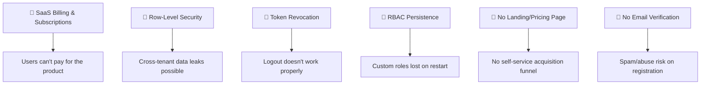

# Ozofi Books Pro — SaaS Readiness Audit

> **Date**: 2026-08-15 | **Scope**: Full codebase review across backend, frontend, database, deployment, and security

---

## Executive Summary

Ozofi Books Pro is a **feature-rich billing platform** with impressive domain coverage — invoices, payments, vendors, procurement, banking, GST, recurring billing, and more. However, it currently operates as a **single-tenant application** with significant gaps that must be addressed before it can function as a true multi-tenant SaaS product.

### Overall SaaS Readiness Score: **42 / 100**

```
████████████████████░░░░░░░░░░░░░░░░░░░░░░░░░░░░░ 42%
```

---

## Dimension-by-Dimension Scorecard

| # | Dimension | Score | Status |
|---|-----------|-------|--------|
| 1 | Multi-Tenancy & Data Isolation | ⭐⭐⭐ 6/10 | 🟡 Partial |
| 2 | Authentication & Session Management | ⭐⭐⭐ 5/10 | 🟡 Partial |
| 3 | Authorization & RBAC | ⭐⭐ 4/10 | 🔴 Critical Gaps |
| 4 | Billing, Subscriptions & Metering | ⭐ 1/10 | 🔴 Not Implemented |
| 5 | Self-Service Onboarding & Provisioning | ⭐⭐ 3/10 | 🔴 Minimal |
| 6 | Scalability & Performance | ⭐⭐⭐ 5/10 | 🟡 Partial |
| 7 | Deployment & Infrastructure | ⭐⭐⭐⭐ 7/10 | 🟢 Good |
| 8 | Monitoring, Logging & Observability | ⭐⭐⭐ 5/10 | 🟡 Partial |
| 9 | Security Hardening | ⭐⭐⭐⭐ 6/10 | 🟡 Partial |
| 10 | Compliance & Data Governance | ⭐⭐ 2/10 | 🔴 Not Implemented |
| 11 | API Design & Documentation | ⭐⭐⭐ 5/10 | 🟡 Partial |
| 12 | Frontend UX & Branding | ⭐⭐⭐⭐ 6/10 | 🟡 Partial |

---

## 1. Multi-Tenancy & Data Isolation — 🟡 6/10

### ✅ What's Working
- **`org_id` on every table** — All major tables (invoices, customers, vendors, products, payments, expenses, etc.) have an `org_id` column with composite unique indexes like `uq_invoices_org_id`, `uq_customers_org_id`
- **Auth middleware injects `req.orgId`** — Extracted from JWT, passed through to queries
- **Composite unique indexes** ensure cross-org uniqueness (`org_id, id`, `org_id, number`, `org_id, sku`)

### 🔴 Critical Gaps

> [!CAUTION]
> **No Row-Level Security (RLS)** — The database has no RLS policies. Data isolation relies entirely on application-level `WHERE org_id = $1` clauses. A single missed filter in any route = cross-tenant data leak.

- **No RLS policies on Supabase** — Despite using Supabase Postgres, no `ALTER TABLE ... ENABLE ROW LEVEL SECURITY` or `CREATE POLICY` statements exist
- **Routes without org_id filtering** — Several queries in [razorpay.js](file:///d:/AI_dev/Google_Antigravity/ozofibooks-improved/backend/routes/razorpay.js) and [auditLog.js](file:///d:/AI_dev/Google_Antigravity/ozofibooks-improved/backend/middleware/auditLog.js) don't consistently enforce org_id
- **`reconcileSalesDrift()`** in [schema.js](file:///d:/AI_dev/Google_Antigravity/ozofibooks-improved/backend/db/schema.js) runs global UPDATE statements without org_id scoping — touches ALL orgs on boot
- **Roles stored in-memory** — [organization.js](file:///d:/AI_dev/Google_Antigravity/ozofibooks-improved/backend/routes/organization.js#L52-L65) uses `orgRolesCache = {}` with no persistence; custom roles vanish on server restart

---

## 2. Authentication & Session Management — 🟡 5/10

### ✅ What's Working
- **bcrypt (cost 12)** for password hashing
- **JWT-based sessions** with 7-day expiry
- **HttpOnly cookies** with secure flag in production
- **Production startup guard** — Server refuses to start if JWT_SECRET is the dev fallback

### 🔴 Critical Gaps

> [!WARNING]
> **No token blacklist/revocation** — [destroySession()](file:///d:/AI_dev/Google_Antigravity/ozofibooks-improved/backend/auth.js#L30-L32) is a no-op (`return Promise.resolve()`). Logging out doesn't actually invalidate the JWT.

- **No refresh token rotation** — Single long-lived JWT; no short-lived access + refresh pattern
- **No email verification** — Registration immediately grants full access
- **No password reset flow** — No forgot-password endpoint despite having `forgotPasswordLimiter` defined
- **Dev superadmin bypass in production-adjacent code** — [auth.js](file:///d:/AI_dev/Google_Antigravity/ozofibooks-improved/backend/routes/auth.js#L57-L62) checks `NODE_ENV !== 'production'`, but staging/test environments would still bypass
- **No MFA/2FA support**
- **No OAuth/SSO** (Google, Microsoft — expected for B2B SaaS)

---

## 3. Authorization & RBAC — 🔴 4/10

### ✅ What's Working
- **Three built-in roles**: `owner`, `admin`, `member`/`staff`
- **requireAuth / requireAdmin / requireOwner** middleware guards
- **Frontend route guards** with `ROLE_PAGE_ACCESS` mapping

### 🔴 Critical Gaps
- **Roles are hardcoded in-memory** — Custom roles created via `/api/org/roles` POST are stored in a plain JS object (`orgRolesCache`) and lost on restart
- **No granular permission checks at the API level** — Backend only checks `owner` / `admin` / not; no per-resource permission like "can this user create invoices but not delete them?"
- **Frontend RBAC != Backend RBAC** — Frontend has a rich `ROLE_PAGE_ACCESS` map, but the backend doesn't enforce the same granularity
- **No org-level feature flags** — Can't restrict features by plan/tier
- **No team invitation flow** — Owner must create accounts directly; no invite-by-email with accept flow

---

## 4. Billing, Subscriptions & Metering — 🔴 1/10

> [!CAUTION]
> **This is the #1 blocker for SaaS.** There is zero subscription/plan infrastructure.

### Completely Missing
- ❌ No pricing tiers / plans table
- ❌ No subscription management (create, upgrade, downgrade, cancel)
- ❌ No payment gateway for *platform billing* (Razorpay is used for customer-to-business invoice payments, not SaaS subscription billing)
- ❌ No usage metering (invoice count, user seats, storage)
- ❌ No trial period logic
- ❌ No billing portal / plan management UI
- ❌ No invoice generation for SaaS fees
- ❌ No webhook handlers for subscription lifecycle events
- ❌ No feature gating based on plan

---

## 5. Self-Service Onboarding & Provisioning — 🔴 3/10

### ✅ What's Working
- **Registration endpoint** creates both org and owner user in a single transaction
- **Schema auto-bootstrap** — `initSchema()` runs on server start, creating all tables idempotently

### 🔴 Critical Gaps
- **No onboarding wizard** — After registration, user lands on an empty dashboard with no guidance
- **No sample/demo data seeding** for new orgs
- **No org profile completion flow** (GSTIN, address, logo)
- **No welcome email** (email integration exists in `.env.example` but no implementation)
- **No account deactivation / org deletion flow**
- **No subdomain or custom domain per tenant**

---

## 6. Scalability & Performance — 🟡 5/10

### ✅ What's Working
- **Connection pooling** with configurable `DB_POOL_MAX`, `min`, `keepAlive`, retry-with-backoff
- **Redis integration** for recurring billing queue and report caching
- **Lazy-loaded frontend routes** with `React.lazy()` + idle-time prefetching
- **Background workers** for scheduled tasks (recurring invoices, scheduler)

### 🔴 Gaps
- **No horizontal scaling strategy** — Single server process, no clustering
- **No CDN for static assets** (Render's static hosting helps, but no explicit CDN config)
- **No database read replicas**
- **Schema bootstrap runs mutations on every boot** — `reconcileSalesDrift()` runs UPDATE/INSERT on production data at startup, which is dangerous at scale
- **No pagination enforcement** — Many `getAllX` queries lack LIMIT guards
- **No query performance monitoring** — No slow query logging or `pg_stat_statements`

---

## 7. Deployment & Infrastructure — 🟢 7/10

### ✅ What's Working
- **Render Blueprint** ([render.yaml](file:///d:/AI_dev/Google_Antigravity/ozofibooks-improved/render.yaml)) — Complete IaC with backend, frontend, Redis, and Postgres
- **Vercel config** ([vercel.json](file:///d:/AI_dev/Google_Antigravity/ozofibooks-improved/vercel.json)) as alternative deployment
- **Auto-deploy on git push**
- **Env var separation** with `.env.example` documenting all required vars
- **Sentry integration** (optional, DSN-gated)
- **Health check endpoint** configured for Render

### 🔴 Gaps
- **No CI/CD pipeline** — No GitHub Actions, no test-before-deploy
- **No staging environment** configuration
- **No database backup strategy** documented
- **No blue-green or canary deployment** strategy
- **Migration system is fragile** — 10 migration files with numbering collisions (two `003_*`, two `004_*`)

---

## 8. Monitoring, Logging & Observability — 🟡 5/10

### ✅ What's Working
- **Structured logger** ([logger.js](file:///d:/AI_dev/Google_Antigravity/ozofibooks-improved/backend/utils/logger.js))
- **Request ID tracking** (UUID per request, set in response header)
- **Audit logging to database** — POST/DELETE/PATCH operations logged with user, org, IP
- **Sentry optional integration**
- **Request duration tracking** in audit middleware

### 🔴 Gaps
- **No application metrics** (request rates, error rates, latency histograms)
- **No health check dashboard** / uptime monitoring
- **No alerting** on error spikes
- **No log aggregation** (CloudWatch, Datadog, etc.)
- **Audit log middleware has a dead code path** — [auditLog.js](file:///d:/AI_dev/Google_Antigravity/ozofibooks-improved/backend/middleware/auditLog.js) `AuditLogger` class uses `db.prepare()` which doesn't exist on the Postgres pool (it's the old SQLite-style prepare)

---

## 9. Security Hardening — 🟡 6/10

### ✅ What's Working
- **Helmet** with CSP, HSTS, noSniff, XSS filter, referrer policy
- **CORS whitelist** with production/dev separation
- **Rate limiting** — Auth (5/15min), API (100/min), sensitive ops, reports, uploads
- **Input sanitization** — HTML entity encoding on all string inputs
- **Zod validation** on auth endpoints
- **Cookie security** — HttpOnly, Secure in prod, SameSite=strict, signed

### 🔴 Gaps
- **SQL injection via string interpolation** — [schema.js L29](file:///d:/AI_dev/Google_Antigravity/ozofibooks-improved/backend/db/schema.js#L29) uses template literals for table names in trigger creation (`${t}`) — safe only because the table names are hardcoded, but it's a dangerous pattern
- **No CSRF token** — Relies solely on SameSite cookies
- **No API key system** for programmatic access
- **No IP allowlisting** option for enterprise tenants
- **Secrets in `.env`** — [.env](file:///d:/AI_dev/Google_Antigravity/ozofibooks-improved/.env) contains actual production Supabase credentials committed (or at risk of being committed)

---

## 10. Compliance & Data Governance — 🔴 2/10

### 🔴 Almost Entirely Missing
- ❌ No Terms of Service / Privacy Policy pages
- ❌ No GDPR data export / right-to-erasure endpoint
- ❌ No data retention policies
- ❌ No cookie consent banner
- ❌ No data processing agreement (DPA) infrastructure
- ❌ No geographic data residency options
- ❌ No SOC2 / ISO27001 preparation
- ❌ Soft-delete (`deleted_at`) exists but no hard-delete or data purge scheduler

### ✅ Partial
- GST compliance built into invoice schema (CGST/SGST/IGST, HSN codes, place of supply)

---

## 11. API Design & Documentation — 🟡 5/10

### ✅ What's Working
- **Consistent response format** via `sendSuccess` / `sendError` helpers
- **Swagger/OpenAPI spec** defined in [swagger.js](file:///d:/AI_dev/Google_Antigravity/ozofibooks-improved/backend/swagger.js) with schema models
- **RESTful route structure** — `/api/customers`, `/api/invoices`, etc.
- **21 route modules** covering comprehensive business domains

### 🔴 Gaps
- **Swagger not mounted** — The spec is defined but the middleware (`swagger-ui-express`) is not imported or used in [server.js](file:///d:/AI_dev/Google_Antigravity/ozofibooks-improved/backend/server.js)
- **No API versioning** — All routes under `/api/` with no version prefix
- **No webhook system for external integrations** (besides Razorpay inbound)
- **No public API documentation** for third-party developers
- **No rate limit headers** communicated to API consumers beyond the limiter's built-in

---

## 12. Frontend UX & Branding — 🟡 6/10

### ✅ What's Working
- **25 feature modules** covering the full business workflow
- **Lazy-loaded routes** with idle-time prefetching
- **Dark/light theme toggle** with system preference detection
- **Error boundary** with retry
- **Toast notification system**
- **Skeleton loading states**
- **Zustand for state management** — Lightweight and appropriate
- **React Query** for server state
- **47KB+ design system** in [index.css](file:///d:/AI_dev/Google_Antigravity/ozofibooks-improved/frontend/src/index.css)

### 🔴 Gaps
- **No landing page / marketing site** — The app goes directly to login
- **No pricing page**
- **No in-app upgrade/billing management**
- **No in-app notifications** (bell icon, activity feed)
- **No keyboard shortcuts / command palette**
- **No mobile responsiveness testing evidence**
- **No i18n / localization** — Hardcoded English strings

---

## Summary of Critical Blockers



---

## Proposed Implementation Roadmap

### Phase 1: SaaS Foundation (Critical — 2-3 weeks)
- [ ] **Subscription & billing system** — Plans table, Stripe/Razorpay integration, feature gating
- [ ] **Row-Level Security** on Supabase — Enforce data isolation at DB level
- [ ] **Token revocation** — Redis-backed JWT blacklist on logout
- [ ] **Email verification** — Send verification email on registration
- [ ] **Persist RBAC** — Move roles to a database table
- [ ] **Landing page + pricing page** — Marketing site with sign-up CTA

### Phase 2: Growth & Hardening (2 weeks)
- [ ] **Self-service onboarding wizard** — Org profile, sample data, guided tour
- [ ] **API versioning** (`/api/v1/`)
- [ ] **CI/CD pipeline** — GitHub Actions with tests + auto-deploy
- [ ] **Password reset flow**
- [ ] **Team invitation via email**
- [ ] **Webhook system** for external integrations

### Phase 3: Scale & Compliance (2 weeks)
- [ ] **Terms of Service & Privacy Policy** pages
- [ ] **GDPR data export / deletion** endpoints
- [ ] **Usage metering & limits** per plan
- [ ] **Application metrics** (Prometheus/Grafana or Datadog)
- [ ] **Database read replicas** for reports
- [ ] **MFA/2FA** support

### Phase 4: Enterprise (Ongoing)
- [ ] **SSO/SAML** integration
- [ ] **Custom domains** per tenant
- [ ] **IP allowlisting**
- [ ] **SOC2 audit preparation**
- [ ] **Multi-region deployment**
- [ ] **API keys** for programmatic access

---

## Open Questions

> [!IMPORTANT]
> ### 1. Payment Gateway for SaaS Billing
> You have Razorpay integrated for customer invoice payments. For SaaS subscription billing (users paying YOU), do you want to:
> - Use **Razorpay Subscriptions** (stays in-ecosystem, good for India-first)
> - Use **Stripe Billing** (global standard, better for international expansion)
> - Support **both** with a gateway abstraction?

> [!IMPORTANT]
> ### 2. Pricing Model
> What pricing model do you envision?
> - **Per-seat** (₹X per user/month)?
> - **Per-feature tier** (Free / Pro / Enterprise)?
> - **Usage-based** (per invoice generated)?
> - **Flat rate** per org?

> [!IMPORTANT]
> ### 3. Tenant Limits
> Should there be hard limits per plan for:
> - Number of invoices/month?
> - Number of team members?
> - Number of customers/vendors?
> - Storage (for warranty claim attachments)?

> [!IMPORTANT]
> ### 4. Target Market Priority
> Is this India-first (GST-focused) or global? This affects:
> - Payment gateway choice
> - Compliance requirements (GDPR vs India's DPDP Act)
> - Currency and tax engine complexity

> [!IMPORTANT]
> ### 5. Migration Cleanup
> You have **numbering collisions** in migrations (`003_clean_relational_rebuild.sql` AND `003_payment_allocation_engine.sql`; `004_database_indexes.sql` AND `004_remove_redundant_org_fks.sql`). Should we renumber and consolidate before proceeding?
